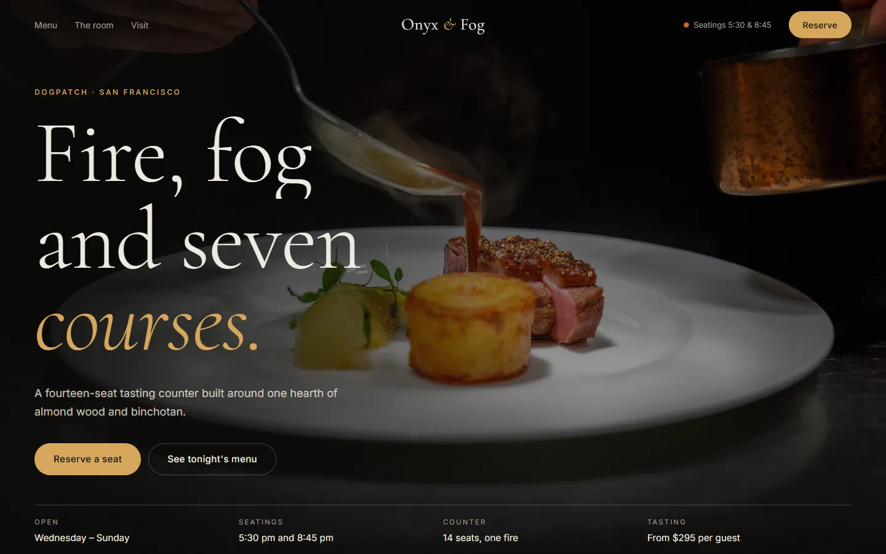

# Onyx & Fog

**A premium website for a fine-dining tasting counter in San Francisco.**

Live demo: https://onyx-and-fog.vercel.app



> Concept project designed and built by [Zain Ali Arif](https://zainaliarif.com). Onyx & Fog is a fictional restaurant: the menu, prices and availability are illustrative and no booking is made.

## Features

- **Cinematic opening**: a curtain intro and a full-screen hero with an elegant serif headline.
- **Scroll choreography**: a word-by-word manifesto reveal, layered parallax and a pinned sideways gallery of seven courses with real food photography.
- **Wine or zero-proof pairings**: one switch updates every course and the reservation price.
- **Reservation flow**: date, time and party size with live availability, a price breakdown (service, tax, deposit), validation, a booking code and a downloadable calendar (.ics) file.
- **Custom cursor**, smooth scrolling and keyboard-friendly controls (roving-tabindex radio groups).
- **Responsive** from small phones to large desktops, with the pinned gallery switching to a swipeable layout on smaller screens.
- **Accessible and fast**: semantic HTML, `prefers-reduced-motion` support, WebP images and a strict Content-Security-Policy.

## Tech

Plain HTML, CSS and JavaScript, with GSAP 3, ScrollTrigger and Lenis vendored locally (no build step). Hosted on Vercel.

## Run locally

Open `index.html` in a browser, or serve the folder:

```bash
npx serve .
```

## Credits

Photography from [Unsplash](https://unsplash.com) (Unsplash License): Urban Gyllström, Anima Visual, Inc inductgroup, Trình Minh Thư, Tadahiro Higuchi, Zion C, Madeline Liu, Alfonso Betancourt, takahiro taguchi and Eirc Shi.
